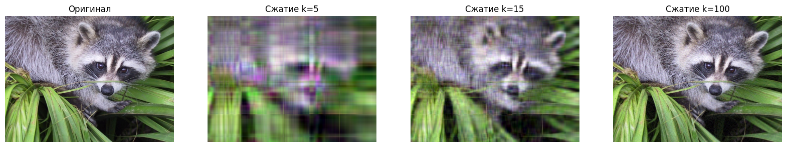
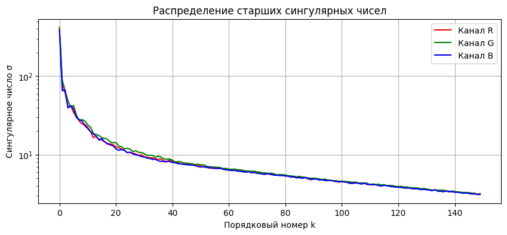
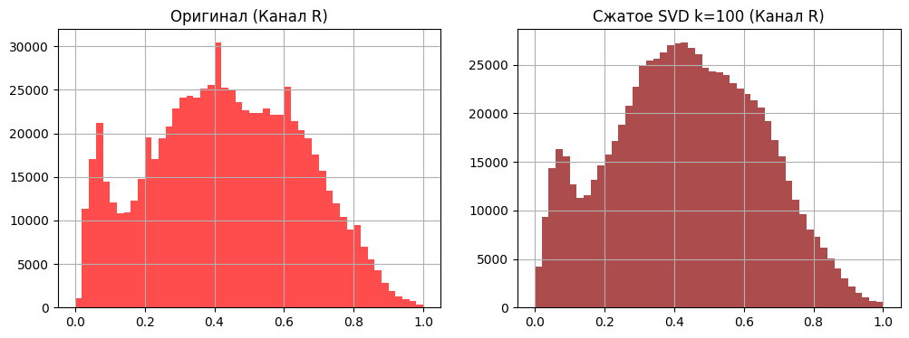

# SVD с нуля: степенной метод, вращения Якоби и сжатие изображений

Сингулярное разложение реализовано на NumPy двумя способами: степенным методом с дефляцией и методом вращений Якоби. Методы сравниваются по точности и вычислительной сложности, а усечённое SVD применяется для сжатия цветного изображения.

Расчётно-графическая работа по курсу «Численные методы алгебры», ИТМО, 2026.

## Что реализовано

- **Степенной метод с дефляцией** (`power_iteration_svd`) находит $k$ старших сингулярных троек $(u_i, \sigma_i, v_i)$. После каждой найденной компоненты её вклад $\sigma_i u_i v_i^T$ вычитается из матрицы.
- **Метод вращений Якоби** (`jacobi_svd_demo`) диагонализует $A^T A$ вращениями Гивенса, на каждом шаге обнуляя наибольший внедиагональный элемент. Даёт полный спектр.
- **Усечённое SVD** $A_k = U_k \Sigma_k V_k^T$ строится для каждого RGB-канала изображения размером 1024×768.

## Результаты

**Сходимость степенного метода.** Ошибка восстановления канала R при $k=50$ (норма Фробениуса):

| Итераций | 10 | 50 | 100 |
|---|---|---|---|
| ‖R − R₅₀‖_F | 55.00 | 54.92 | 54.92 |

Метод сходится примерно за 50 итераций.

**Сверка методов.** На блоке 15×15 метод Якоби сошёлся за 212 вращений. Пять старших сингулярных чисел совпали со степенным методом до второго знака: `[7.17, 1.39, 0.92, 0.44, 0.24]`.

**Сжатие.** При $k=100$ на канал нужно хранить 179 300 чисел вместо 786 432, то есть коэффициент сжатия ≈ 4.4. Визуально изображение почти неотличимо от оригинала.





**Сложность.** Для поиска $k \ll n$ старших компонент степенной метод ($O(k \cdot N \cdot n m)$) выгоднее Якоби ($O(m^3)$ на полный спектр). Оценка для матрицы 640×640 и $k=50$ даёт разницу примерно в 3.3 раза.

**Гистограммы яркости** оригинала и сжатого изображения практически совпадают: усечение убирает высокочастотные детали, но не меняет общее распределение яркости.



## Структура

```
svd_image_compression.ipynb   теория, реализация, эксперименты, выводы
image.jpg                     тестовое изображение (scipy.datasets.face)
figures/                      графики из ноутбука
```

## Запуск

```bash
pip install -r requirements.txt
jupyter notebook svd_image_compression.ipynb
```

Подойдёт любое изображение не меньше 640×640: положите его в корень как `image.jpg`.

## Стек

Python, NumPy, Matplotlib, Pillow

## Авторы

Роман Чугуевский, Ксения Ковалева

Тестовое изображение — `face` из набора данных SciPy (лицензия BSD).
